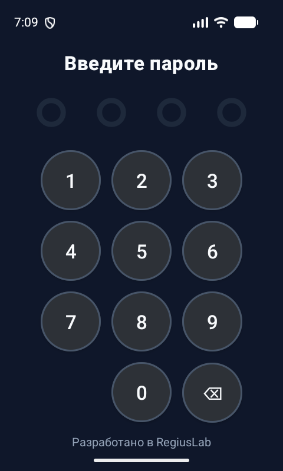
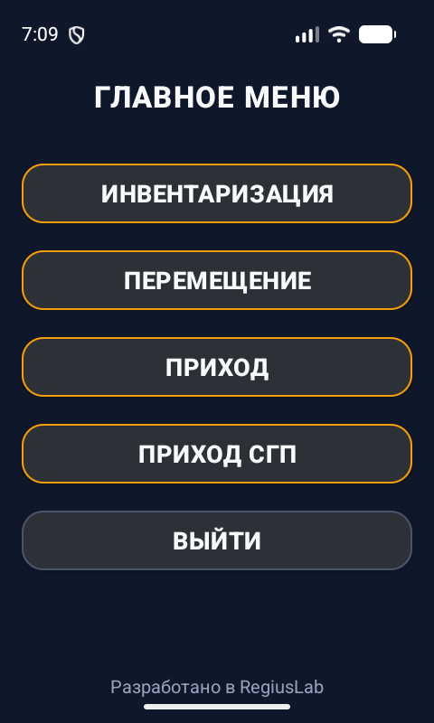
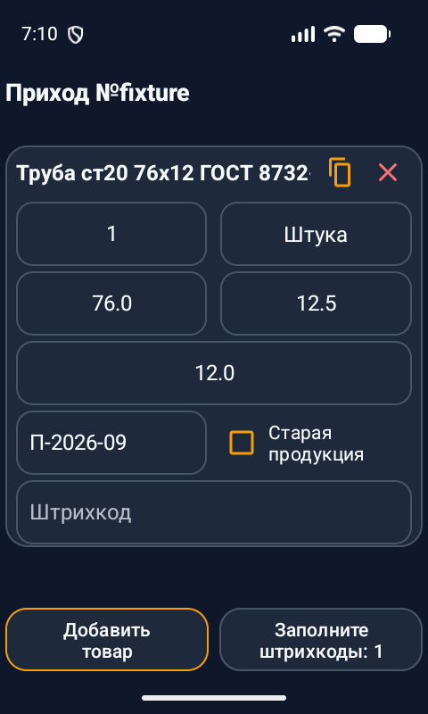
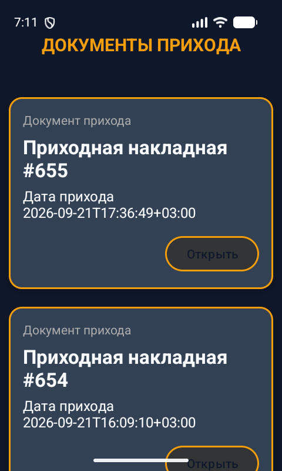
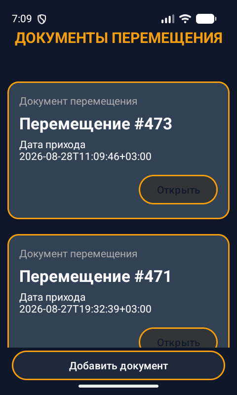
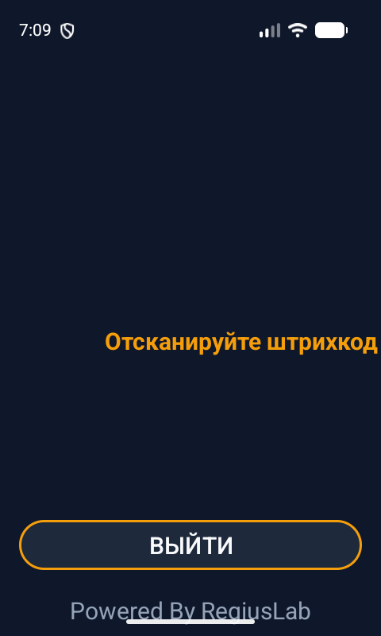
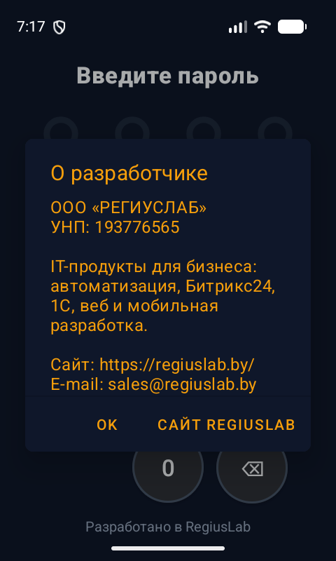

# Демо для директора — ScannerKotlin (ТСД «Склад»)

Пакет скриншотов: `demo-director/` (480×800 @ 240dpi, Industrial Modern).  
Сборка: debug APK; разработчик — **ООО «РЕГИУСЛАБ»** ([regiuslab.by](https://regiuslab.by/)).

---

## Что показывает приложение

Мобильный клиент склада (ТСД) к Bitrix24: PIN → меню → документы прихода/перемещения, инвентаризация, приход СГП, ОТК.  
Сканер железа шлёт штрихкод в приложение; проведение документов — через REST Bitrix.

---

## Скриншоты экранов

| № | Экран | Файл | Комментарий |
|---|--------|------|-------------|
| 1 | Авторизация (PIN) |  | 4 цифры, брендинг RegiusLab |
| 2 | Главное меню |  | Инвентаризация / Перемещение / Приход / СГП / Выйти |
| 3 | **Приход — карточка товара** *(доработано)* |  | Длинное имя (marquee), поля без налезания, штрихкод на экране |
| 4 | Список документов прихода |  | Черновики из Bitrix, «Открыть» |
| 5 | Список документов перемещения |  | Черновики + «Добавить документ» |
| 6 | Инвентаризация |  | Список отсканированных (пусто до скана) |
| 7 | Приход СГП |  | Экран проведения СГП |
| 8 | ОТК |  | Роль ОТК: скан процесса качества |
| 9 | Документ перемещения (позиции) |  | Карточка позиций / пустой список до скана |
| 10 | О разработчике («Разработано в RegiusLab») |  | Диалог по тапу на подпись внизу PIN / меню |

Копии ключевых экранов для README: `design-auth-480x800.png`, `design-main-480x800.png`, `design-coming-480x800.png`.

---

## Что доработано в UI (приход)

Для ТСД 480×800:

1. **Страницы на весь экран** — карточка товара и комментарий больше не «склеиваются» в одном кадре.
2. **Название товара** — длинные имена читаются с начала; полный текст уходит медленным горизонтальным скроллом (marquee).
3. **Поля ввода** — фиксированная высота 48dp, зазоры между рядами, spinner единицы измерения не наезжает на соседние поля.
4. **Тема Industrial Modern** — slate/amber, скруглённые кнопки и поля, современные иконки копирования/удаления.

---

## Перенос настроек Bitrix в конфиги

**Было:** host, вебхуки, iblock и роли размазаны по коду / сложно менять под другого клиента.

**Стало:** один контур настроек на сборку, без правок Kotlin.

| Слой | Назначение |
|------|------------|
| `bitrix.properties.example` | Шаблон для нового клиента |
| `bitrix.properties` | Локальные секреты портала (в `.gitignore`) |
| `local.properties` | Опциональный override (выше приоритет) |
| `app/build.gradle.kts` → `BuildConfig` | Значения попадают в сборку |
| `config.BitrixConfig` / `BitrixClientFactory` | Код читает только отсюда |

**Приоритет:** `local.properties` → `bitrix.properties` → defaults в Gradle (текущий контур izocom).

**Что вынесено:** host, userId REST, 3 webhook-токена (catalog / barcode scan / barcode coming), iblock PIN/товары/offers, роли кладовщик/ОТК, имя тенанта.

**Смена клиента Б24:**

```text
1. Скопировать bitrix.properties.example → bitrix.properties
2. Подставить host, токены, iblock, роли
3. ./gradlew clean assembleDebug
```

После этого приложение ходит на новый портал без изменений в `activities` / `service`.

---

## Как воспроизвести скрины

```bash
./gradlew installDebug
# debug-launcher:
adb shell am start -n com.example.scannerkotlin/.debug.DemoScreenFixtureActivity --es screen main
adb shell am start -n com.example.scannerkotlin/.debug.ComingLayoutFixtureActivity --ez longName true
```

Экраны: `auth` | `main` | `coming-list` | `moving-list` | `scan` | `sgp` | `otk` | `moving-products`.
